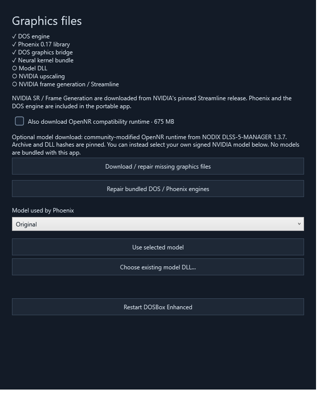
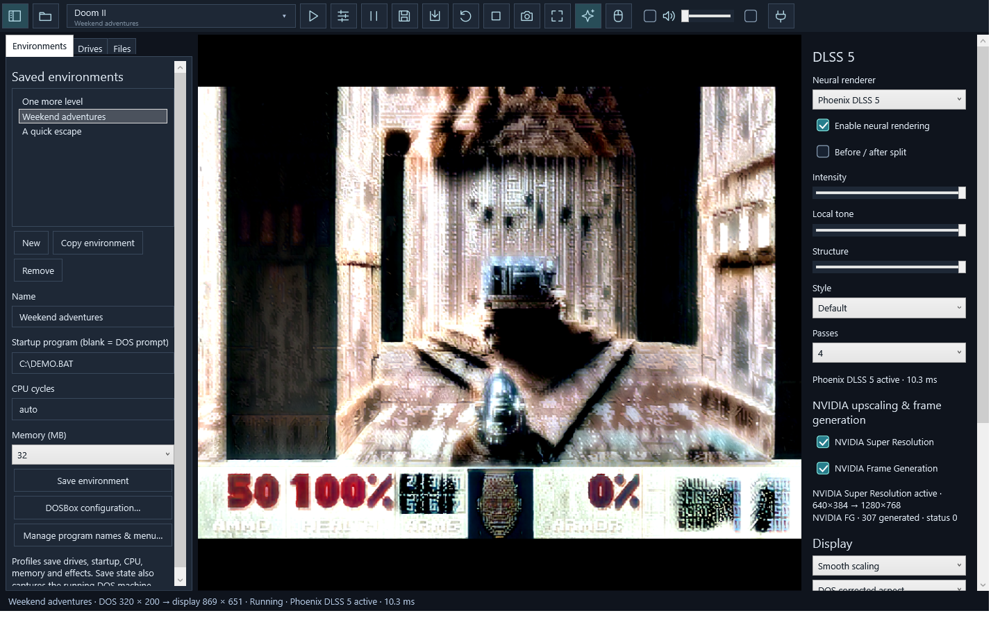
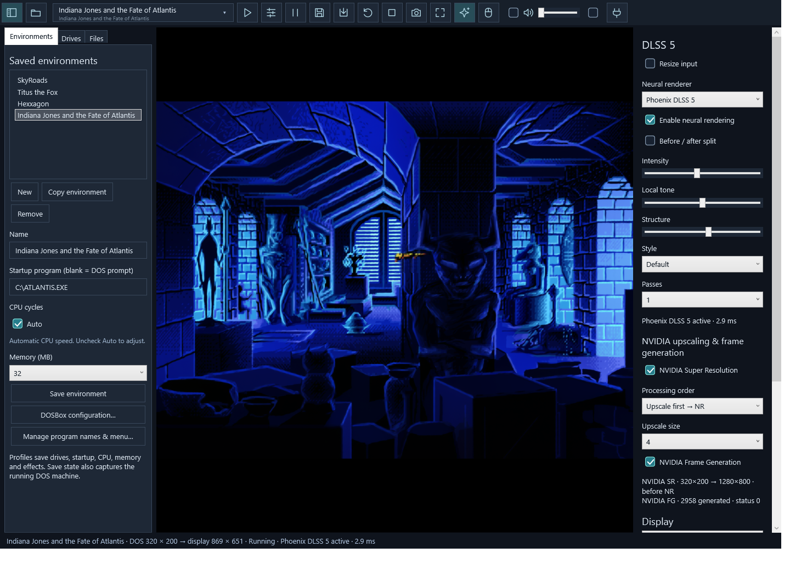
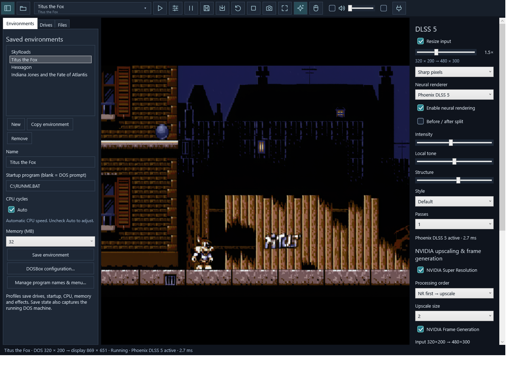
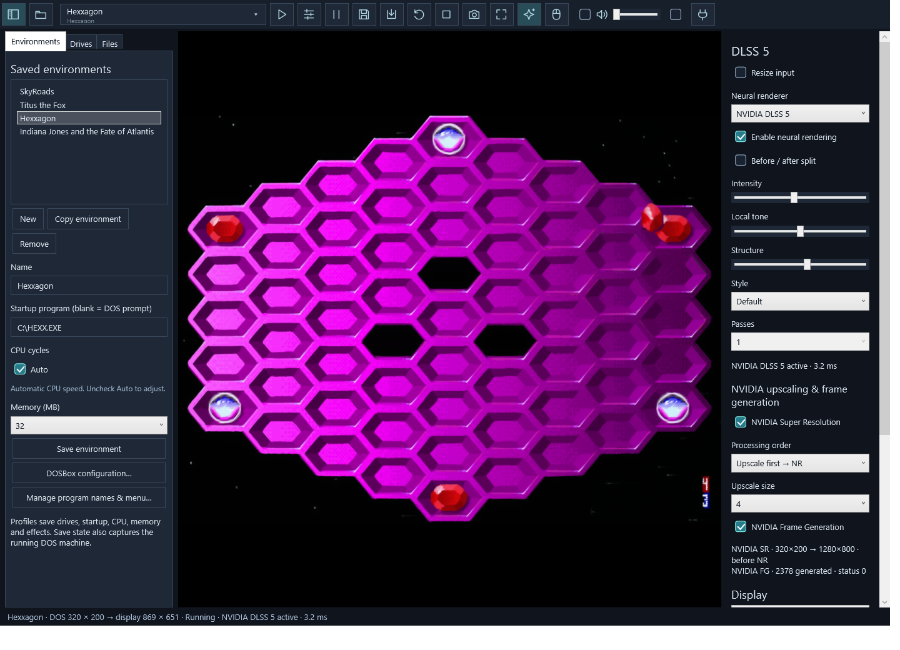
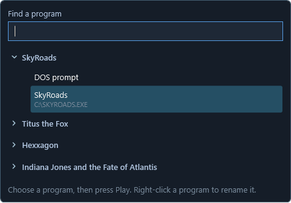
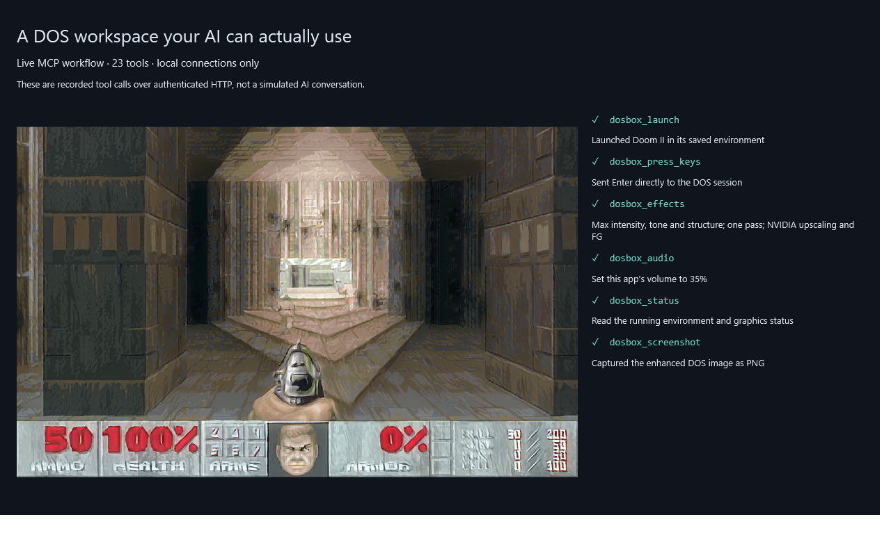

# DOSBox Enhanced - Quick settings, DLSS5 and MCP

DOSBox with saved environments, optional DLSS graphics, and built-in MCP.

[Download Windows v0.6.2](https://github.com/RazvanManolache/dosbox-enhanced/releases/download/v0.6.2/DOSBox-Enhanced-0.6.2-win-x64.zip) · [All release files](https://github.com/RazvanManolache/dosbox-enhanced/releases/tag/v0.6.2)

- Set up drives and settings once, then pick a game and press Play.
- Keep multiple environments, each with its own DOSBox and graphics settings.
- Run an EXE, COM or BAT directly without creating an environment.
- Connect an AI client to configure DOSBox, manage environments and control games.


- Four games, four saved environments; all captures use **one neural pass**.
- Game showcase images are retained from v0.5; new setup/control screenshots are from v0.6.
- [Selected settings, before/after images and all 40 trials](docs/GAME_GALLERY.md).

## Features

- **Drives:** map multiple folders, browse files and create folders inside mapped drives.
- **Program picker:** searchable tree grouped by environment; friendly names, custom order and hidden entries. Automatic discovery is optional.
- **Environment copies:** duplicate settings while sharing mapped game folders.
- **CPU speed:** Auto checkbox, live manual slider and exact cycle value. Auto remembers the last manual speed.
- **DOSBox configuration:** CPU, memory, video, audio, MIDI, input, networking, core options and an Advanced INI editor, saved per environment.
- **Session controls:** pause, restart, save/load state, screenshots, volume and mute.
- **Panels:** toggle the environment and effects panels independently.
- **Fullscreen:** F11; hold the free pointer still at the top for one second to reveal the menu.
- **Mouse capture:** Caps Lock releases the pointer; the shortcut is configurable.
- **Quick run:** open or drop a DOS EXE, COM or BAT with an 8.3 filename; its folder mounts as C:.

## New in 0.6.2

- **Background automation:** `--background` starts minimized without focus, fullscreen or pointer capture. Errors go to the local log instead of blocking on a dialog.
- **Better small-text inspection:** MCP OCR can crop the DOS frame and isolate yellow or white prompts.
- **Less impatient clicking:** choose the DOS mouse-button hold time for games that need a longer press.
- **Phoenix 0.19 source pin:** the addon-only presentation and label controls stay in the addon; DOSBox continues using the standalone native interface.

## Added in 0.6

- **Phoenix 0.17:** Original and Lightweight models, with compatible native graphics integration.
- **Advanced controls:** temporal reuse, auto mask, skin detail, neural processing scale, eight block repeat counts and central block count.
- **Performance:** target FPS / processing-time budgets, priority and optional GPU monitoring.
- **Color finishing:** brightness, contrast, saturation and gamma. Advanced controls are grouped into collapsible panels; quick sliders show their values.
- **Graphics setup:** inspect missing components, download verified NVIDIA runtimes, optionally download the pinned community OpenNR runtime, or choose your signed NVIDIA model. Restart applies the selected files.
- **Component repair:** restore the bundled engines from this release, with GitHub's release digest and per-file checksums.
- **MCP:** configure the same advanced Phoenix settings per environment.



## DLSS graphics

- **Input resize:** optional 0.25×–4× slider before NR/SR, including fractional sizes such as 1.25× and 1.5×, with a live resolution preview and sharp/smooth filtering. Off by default.
- **Neural renderer:** Phoenix DLSS5 or NVIDIA DLSS5.
- **Effects:** intensity, tone, structure, color styles and a before/after split. Phoenix DLSS5 supports multiple passes.
- **Upscaling:** NVIDIA Super Resolution, with a separate enable switch.
- **Frame Generation:** NVIDIA FG, with its own switch and generated-frame counter.
- **Processing order:** NR → NVIDIA upscale (default), or NVIDIA upscale → NR.
- **Upscale size:** NVIDIA SR adds 2×–4× to the processing input. Disable both input resize and SR to keep native-size processing. Display preserves the selected DOS aspect ratio.


- Gallery presets were chosen per game from **ten combinations each**; intensity **0.9**, tone **1.0**, structure **1.1**, **one pass**.
- SkyRoads / Atlantis: SR 4× before Phoenix DLSS5. Titus: sharp 1.5× input → Phoenix DLSS5 → SR 2×. Hexxagon: SR 4× before NVIDIA DLSS5 NR.
- [Exact presets for the UI or MCP](docs/GAME_PRESETS.json); these are starting points for the pictured scenes.
- Real app captures; the comparison uses the same frozen source frame. Stills cannot demonstrate Frame Generation.
- Experimental: image-derived motion and flat depth can cause artifacts in scrolling, text and pixel art.
- Tested on **RTX 5080**; bundled Phoenix DLSS5 kernels target **sm_120**. Other GPUs are not certified for this release.
- Graphics are optional; use the in-app setup panel to download runtimes and an optional model, or choose your own model DLL.
- [Graphics setup](docs/GRAPHICS.md) · [Capture method and runtime counters](docs/CAPTURES.md)

<details>
<summary>Four passes: too much of a good thing</summary>



The GPU has started taking artistic liberties. Four passes, maximum strength, captured with the earlier fixed-canvas path; not a recommended preset. Main screenshots use one pass.

</details>



| Titus the Fox · fractional input | Hexxagon · NVIDIA DLSS5 renderer |
|:---:|:---:|
|  |  |



## Built-in MCP

- **No extra server installation:** no Python or Node required.
- **23 tools:** environments, programs, drives, DOSBox settings, effects, audio, keyboard/mouse, session controls, screen text and screenshots.
- **Access:** disabled by default; local connections only, authenticated by a key. Remote connections require an explicit checkbox.
- **Permissions:** observation mode exposes eight read-only tools; control mode enables all 23.
- **Setup:** open the plug icon, enable MCP, then copy the client configuration and AI instructions.
- [MCP setup and tool reference](docs/MCP.md)



Actual authenticated HTTP tool calls and the returned screenshot; not an AI chat transcript.

## Run

1. Extract the **Windows x64 portable archive** from Releases to a writable folder.
2. Open **DOSBox Enhanced.cmd**. The .NET runtime and DOS engine are included.
3. Create an environment, map game folders under **Drives**, select a program and press Play. Or drop a DOS executable onto the window.
4. Optional: [set up graphics](docs/GRAPHICS.md).

- **Windows:** 10 build 19041+ or Windows 11.
- **Bring your own games:** no games, personal profiles, saves or model weights included.
- Keep `app/` and `runtime/` together. Settings and saves go in `data/`.
- Mapped game folders are writable. Environment copies share those folders; they do not copy game files.
- Save states depend on the core, machine settings and external game files.
- [User guide](docs/USER_GUIDE.md)

## Build

The project root is also the GitHub checkout: one source tree for development,
builds and releases. `release/` contains generated packages and private receipts.

```powershell
git submodule update --init --recursive
.\build.ps1
```

- **Host:** C# / WPF, embedded DOSBox Pure; requires .NET 9 SDK and PowerShell.
- **Graphics:** native D3D12 bridge; building adds MSVC, CMake and the Phoenix DLSS5 SDK. Phoenix DLSS5 source/kernel builds need additional development tools.
- **Dependencies:** pinned Git submodules and lock file; Phoenix DLSS5 0.19 source, native tuning and shared processing pipeline.
- **Portable app:** does not need those development tools.
- [Build instructions and CI](BUILDING.md) · [Release validation](docs/VALIDATION.md)

## Credits

- [DOSBox Pure](https://codeberg.org/schelling/dosbox-pure) — Bernhard Schelling and contributors, based on DOSBox.
- [Phoenix DLSS5](https://github.com/RazvanManolache/dlss5-phoenix-addon) — standalone neural-rendering library.
- [NVIDIA DLSS](https://github.com/NVIDIA/DLSS) and [Streamline](https://github.com/NVIDIA-RTX/Streamline) — NVIDIA graphics integration.
- Independent project; **0.5 is an early experimental release**.
- [Licenses and notices](THIRD_PARTY_NOTICES.md). Game artwork belongs to its respective creators.
