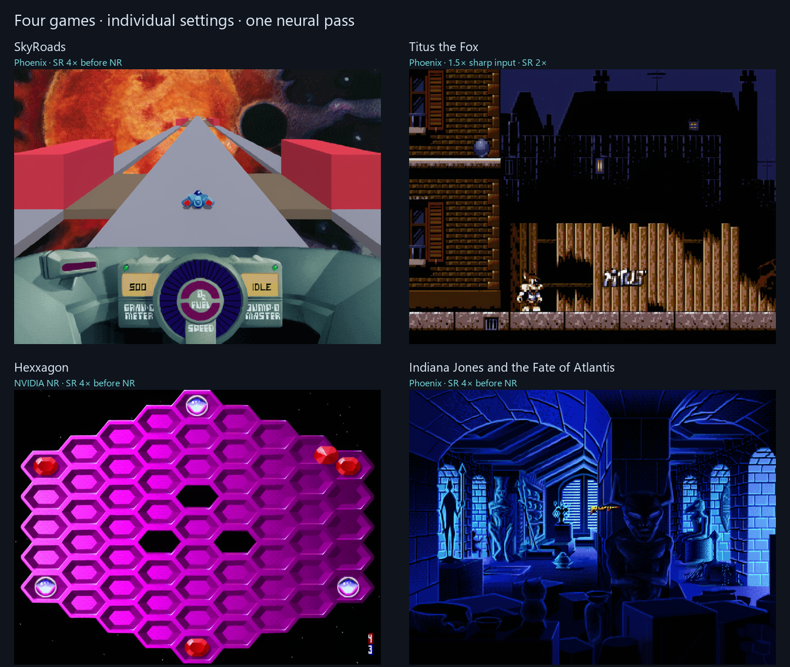
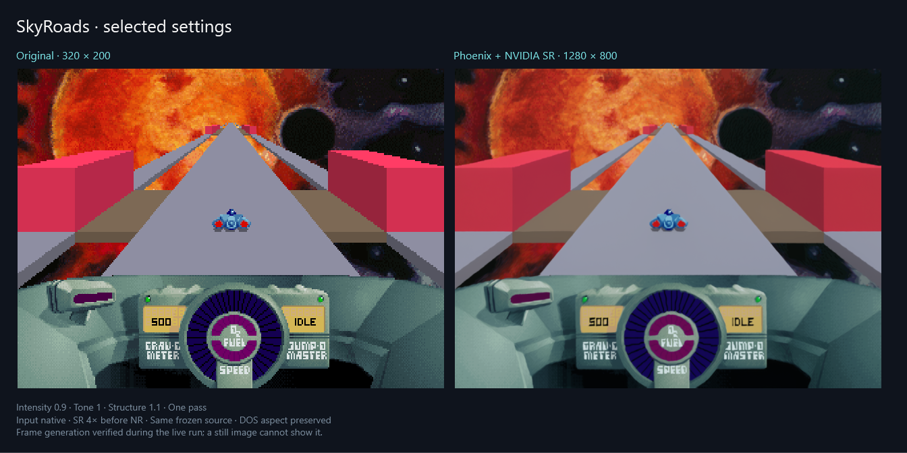
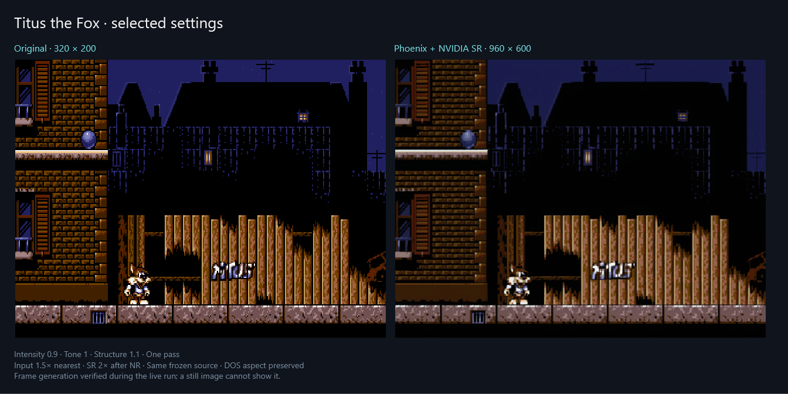
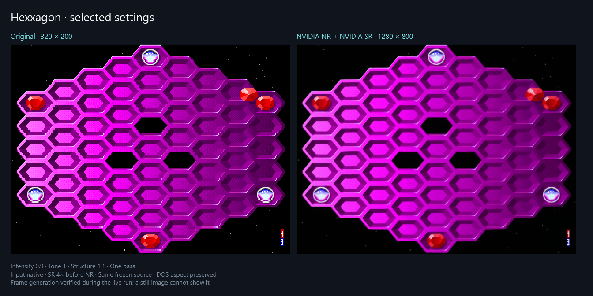
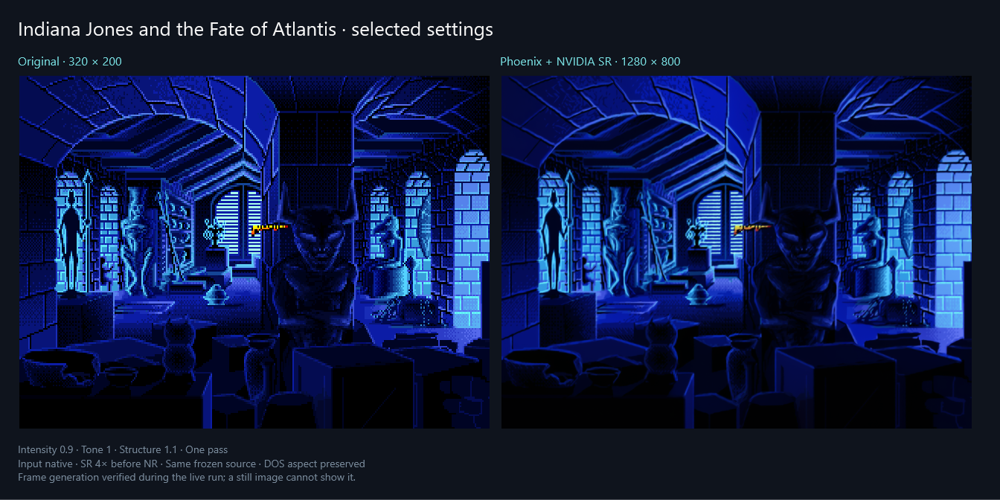

# Four games, individual settings

- Ten combinations per game, compared on the same frozen frame: **40 trials**.
- All selected presets use **one pass**, intensity **0.9**, tone **1.0**, structure **1.1**, default color style.
- NVIDIA SR and Frame Generation enabled. New generated presentations were observed in every live session with NVIDIA status bits **0**.
- Settings favor intact shapes, readable labels and fewer invented contours. These are subjective starting points for the pictured scenes.
- DOS aspect ratio is preserved. No game files, host paths, personal environments or model weights are included.

| Game | Renderer | Input | Order | Output before display aspect correction |
| --- | --- | --- | --- | --- |
| SkyRoads | Phoenix | Native 320×200 | SR 4× → NR | 1280×800 |
| Titus the Fox | Phoenix | Sharp 1.5×: 480×300 | NR → SR 2× | 960×600 |
| Hexxagon | NVIDIA NR | Native 320×200 | SR 4× → NR | 1280×800 |
| Indiana Jones and the Fate of Atlantis | Phoenix | Native 320×200 | SR 4× → NR | 1280×800 |

- [Exact settings as MCP tool arguments](GAME_PRESETS.json): apply `arguments` to `dosbox_effects` with the intended environment selected.
- [Runtime observations, all candidate settings and image hashes](GALLERY_EVIDENCE.json).
- A still image cannot show frame generation or prove motion quality. These captures are not FPS benchmarks or complete compatibility tests.

## SkyRoads

- SR first keeps the road edges and cockpit labels steadier than maximum-strength native NR.
- Captured on a road, with the ship and cockpit visible.
- [Live UI](images/gallery-skyroads-workspace.png) · [All ten trials](images/gallery-skyroads-trials.png) · [Trial source](images/gallery-skyroads-trial-source.png).

## Titus the Fox

- Sharp 1.5× input retains more narrow fence and sprite detail; smooth pre-resize softened them.
- Captured in the first level, past the title and level-introduction screens.
- [Live UI and fractional slider](images/gallery-titus-workspace.png) · [All ten trials](images/gallery-titus-trials.png) · [Trial source](images/gallery-titus-trial-source.png).

## Hexxagon

- NVIDIA NR after SR keeps the bright grid outlines and dark background closer to the source than maximum-strength Phoenix.
- The final capture shows the populated board. Trials use its board-building scene; the two phases are labeled separately in the evidence.
- [Live UI and NVIDIA renderer](images/gallery-hexxagon-workspace.png) · [All ten trials](images/gallery-hexxagon-trials.png) · [Trial source](images/gallery-hexxagon-trial-source.png).

## Indiana Jones and the Fate of Atlantis

- SR first preserves more brickwork and door trim; maximum native NR bends fine lines.
- Captured during the museum opening scene.
- [Live UI](images/gallery-atlantis-workspace.png) · [All ten trials](images/gallery-atlantis-trials.png) · [Trial source](images/gallery-atlantis-trial-source.png).

## Reproduce

- Use a disposable app/data folder and copies of your own games.
- The developer `--showcase` workflow accepts `gallery: true`, per-game `effects`, and keyboard/mouse action sequences; `explore: true` saves intermediate DOS screens for choosing a scene.
- `tests/graphics_pipeline_probe.py` accepts renderer, strength, tone, structure, processing order, SR factor and fractional input factor. Its optional Python dependencies are development tools; the app does not require them.
- Original images use nearest-neighbor fitting; enhanced images use smooth fitting at the same DOS display aspect. Final comparisons use a new frozen source with the selected preset.
- Game artwork and trademarks belong to their respective creators and rights holders. No game downloads are included.
