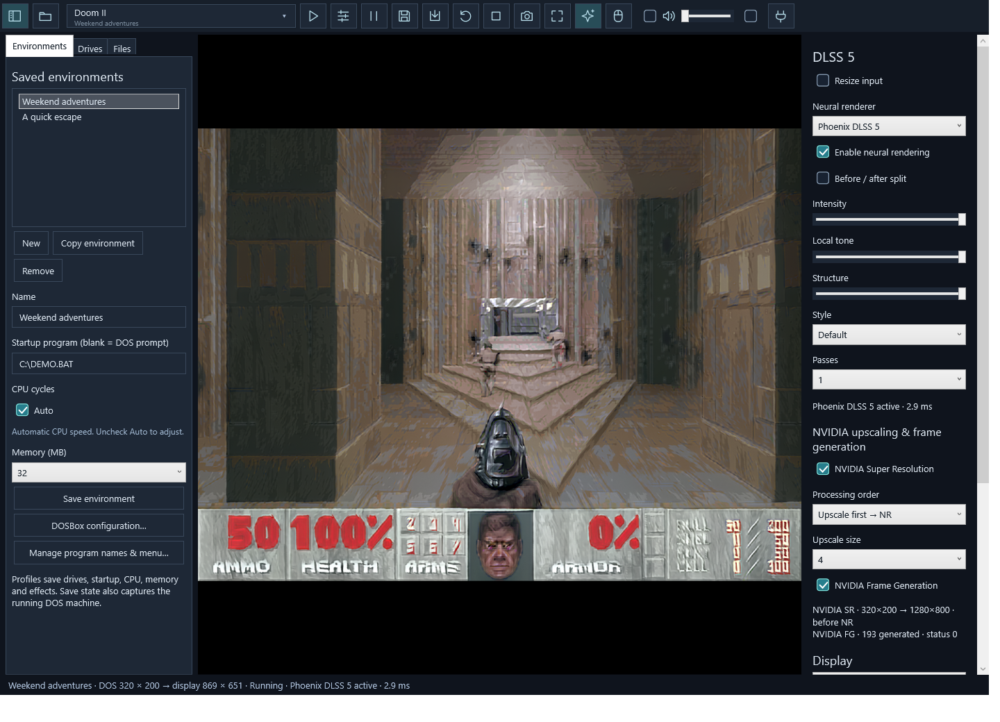
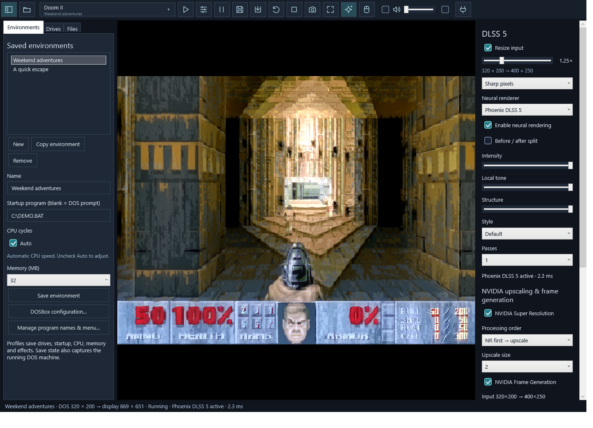

# One-time graphics setup

The portable app plays DOS games immediately. Neural rendering is optional.

1. Obtain a compatible, signed `nvngx_dlssnr.dll` model separately. No model DLL
   or extracted weights are supplied by this project.
2. Close DOSBox Enhanced, double-click **Setup graphics.cmd**, and select that
   file. The setup downloads NVIDIA's pinned Streamline 2.14.1 SDK, verifies the
   archive hash, extracts the required signed runtimes and retains their terms.
3. Start the app again. Choose Phoenix or NVIDIA in the effects panel and adjust
   the controls. Keep your selected model DLL at its chosen location.

The app includes the model-free Phoenix native library and sm_120 kernels in the
portable package. These were tested on RTX 5080; other GPU architectures are not
certified. DLSS Super Resolution / Frame Generation also require a compatible
NVIDIA GPU and driver. A graphics error falls back to the original DOS picture.

For offline setup, run:

```powershell
.\setup-graphics.ps1 -Model C:\Models\nvngx_dlssnr.dll -NvidiaSdkArchive C:\Downloads\streamline-sdk-v2.14.1.zip
```

The official SDK URL, file hashes and version are in `runtime.lock.json`.
Configuration is generated locally in ignored `graphics.json`; caches and
downloads go under ignored `data/`. Your model is referenced, not copied. It is
never included by the release packager. NVIDIA components keep their own terms.

## Processing order

- **NR first → upscale** (default): process the native DOS frame, then run NVIDIA SR.
- **Upscale first → NR**: run NVIDIA SR on the native frame, then process the larger image.
- **Upscale size**: 2×, 3× or 4× native dimensions. A 320×200 game at 4× produces 1280×800 before DOS aspect correction for display.
- **SR off**: NR and output stay at the input dimensions (native unless optional input resize is enabled). Window scaling is separate.
- Input resize is optional and off by default. Drag the 0.25×–4× slider in 0.05× steps, including 1.25× and 1.5×. A live preview shows the actual pixel dimensions; release the mouse to apply. Choose sharp (nearest-neighbor) or smooth (bilinear) filtering. It runs before both NR and SR and is independent of their switches.
- With input resize on, NR and SR receive the resized input. Input 1.25× plus SR 2× gives 2.5× total output (320×200 → 400×250 → 800×500). With both resize and SR off, processing stays native.
- Motion is estimated from the processing input; SR-first rescales the NR motion vectors to match its larger input.
- Order and size are saved per environment and exposed through MCP. Resolution or layout changes recreate graphics resources and reset temporal history.

Graphics use estimated image motion and a flat depth plane. No real 3D engine
geometry is available. Temporal artifacts are possible; this experiment does not
promise better image quality or a particular frame rate in every game.





## Per-game starting points

- [Four-game gallery, settings and 40 comparison trials](GAME_GALLERY.md).
- [Preset arguments for MCP](GAME_PRESETS.json); apply them to a separate environment for each game.
- Keep one pass. Native NR at maximum strength often deforms thin pixel-art lines; try SR first or a sharp fractional input resize.
