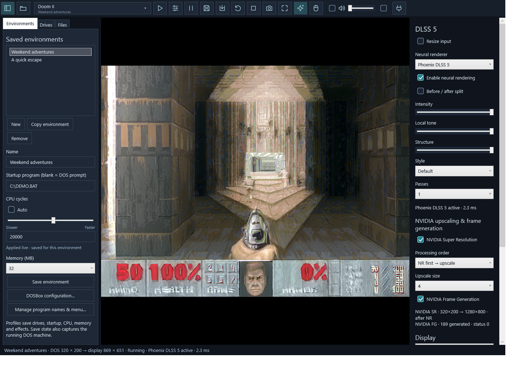

# Your DOS workspace

## Start once, remember next time

The first launch creates an empty environment and its own C: folder. Under
**Drives**, map a game folder as a drive, or add several folders with different
letters. Under **Files**, browse and double-click a DOS executable. Save the
environment to keep its name, startup, drives, CPU, memory and graphics controls.

The program picker searches all saved environments. Expand an environment or
type part of a name or DOS path. Selecting a program selects its environment;
Play launches it. Right-click a program to give it a friendly name. The sliders
icon manages visibility, names, order and automatic additions. Hidden programs
stay hidden after rescanning. Missing entries remain in the manager.

**Copy environment** copies settings and mappings, not game files. Two profiles
pointing at the same folder share the game's files and saves. Change the copy's
mapping for separate files. Removing a profile leaves its folders and states.

In **Files**, **New folder…** creates a real subfolder inside the mapped folder.
Game writes go to your mapped host folders. Back up saves you care about.

## Just run this one

Open or drop an EXE, COM or BAT on the app. Its parent folder becomes C:, and
the executable runs. Quick run requires a DOS 8.3 name. For long names or several
drives, use a saved environment. Command-line quick run works too:

```powershell
& .\app\DosboxEnhanced.exe C:\DOS\GAME\GAME.EXE
```

## Input and fullscreen

Click the game to capture the mouse. The first click captures without pressing
a DOS mouse button. **Caps Lock** frees it without changing Windows or DOS Caps
Lock; the mouse icon lets you choose a different shortcut, pointer visibility,
capture-on-click and sensitivity. Pause, focus loss and closing release capture.

**F11 / Alt+Enter** toggles fullscreen. With a free pointer, hold still at the
very top for one second to show the toolbar. Moving restarts the timer. Opening
the program picker keeps the toolbar visible. The environment and sparkle icons
show/hide their own panels. **Ctrl+F10** is an extra release/menu shortcut.

## Settings and saves

**DOSBox configuration…** in the environment tab offers searchable categories,
the installed core's options, and an Advanced INI page. Extra keys survive
switching between the structured controls and INI. **Save & reload DOS** restarts
the machine to apply changes. Engine support determines which settings work.
Drive/startup commands are managed by the app rather than imported autoexec.

Save/load state stores the running DOS machine in one slot per environment or
quick-run program. States require matching machine settings, core and game
files. DOSBox Pure may reject saving at a DOS prompt or BAT pause; save during
a running executable. An environment profile is not a save state.

Volume and mute affect this app. Screenshots save the currently displayed frame
as PNG in `data/screenshots`. Window/panel, audio and mouse preferences are in
`data/preferences.json`; profiles are in `data/environments.json`. These files
are your local data, not release content.

See [graphics setup](GRAPHICS.md) for optional DLSS paths and [MCP](MCP.md) for
connecting an AI. MCP is disabled by default and local-only unless you enable
remote access. The app's options panel supplies client settings and instructions.

## Graphics order and size

- **NR first → upscale:** native-resolution neural rendering, then NVIDIA SR.
- **Upscale first → NR:** NVIDIA SR, then neural rendering at the larger size.
- **Upscale size:** 2×, 3× or 4× native resolution; saved with the environment.
- **Resize input:** optional 0.25×–4× sharp/smooth resize before NR and SR; disabled by default. Drag the slider for fractional sizes (0.05× steps), see the pixel preview, and release to apply. Its size is independent of the SR multiplier.
- **NVIDIA Super Resolution off:** processing stays at the input dimensions. Turn input resize off too for native size. Window fitting remains under Display.

## CPU speed

- **Auto** chooses CPU speed automatically and hides the manual controls.
- Uncheck it for a draggable speed slider and exact cycle value. The slider gives more room to slower settings.
- Changes apply live after dragging stops, or when you press Enter/leave the value field. No restart is needed for common auto/fixed/max settings.
- Auto remembers the last manual value separately for each environment.
- Advanced cycle syntax stays in the DOSBox configuration editor. Replacing an advanced fixed setting may need a DOS reload; the panel reports this.


